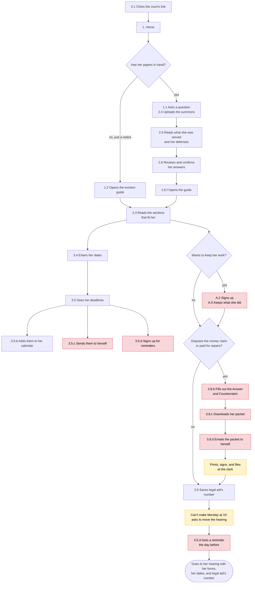

# Eviction action inventory: tenant

Every action a tenant can take on the eviction path at Franklin County Municipal Court's instance, with its route and whether it's built. Mapped from the code on `main` as of 2026-11-16 (b20fec4a), following Jane Martin's eviction story ([#26](https://github.com/freelawproject/litigant-portal/issues/26)). Tracked in [#1196](https://github.com/freelawproject/litigant-portal/issues/1196).

When the code and this doc disagree, trust the code and fix the doc. As MVP gaps get issues, link them from the action they cover.

The doc has three parts, each backing the next:

1. **Jane's story:** why she needs the actions at all.
2. **User flow:** her path in order, with its decision points. Each step names the inventory action it uses.
3. **Action inventory:** every action, screen by screen, with its route.

A step in the flow with no inventory number is a gap that neither list caught on its own.

## Jane's story

Jane Martin's story ([#26](https://github.com/freelawproject/litigant-portal/issues/26)) is set in DuPage County, Illinois. Here she's moved to Franklin County, Ohio, where the tenant flow lives; the Franklin County stories ([#720](https://github.com/freelawproject/litigant-portal/issues/720), [#722](https://github.com/freelawproject/litigant-portal/issues/722)) replaced it for that court. What she needs, and what in the product answers it:

| Jane's situation                                                   | What she needs                                             | Actions                                      |
| ------------------------------------------------------------------ | ---------------------------------------------------------- | -------------------------------------------- |
| Served eviction papers; doesn't know what they mean                | A plain-language explanation of what she got               | 2.4, 2.5, 3.3                                |
| Behind on rent after a car repair wiped out her savings            | Her options and defenses                                   | 2.5, 3.3                                     |
| Paid for repairs the landlord never reimbursed                     | A counterclaim, and to know it's an option                 | 3.3, 3.8                                     |
| Earns too much for legal aid (she thinks), too little for a lawyer | Free help she can actually use                             | 3.6, S.1                                     |
| Uses her phone after the kids are in bed                           | Everything on a phone, at night, with no clerk open        | All; mobile-first                            |
| Hearing is Monday at 10 am, during her workday                     | Her dates, reminders, and whether she can move the hearing | 3.4, 3.5, **content gap** (moving a hearing) |
| Can't afford court costs or back rent                              | Fee waiver, rental assistance                              | 3.8, **content gap** (rental assistance)     |
| Embarrassed; "doesn't know what she doesn't know"                  | Private, no judgment, nothing she has to ask a person      | Anonymous use; P.6, A.5                      |

## User flow

Jane's main path, from the court's link to her hearing. Red steps are MVP gaps. A step with no inventory number has no action yet.

Red = MVP gap in the inventory · yellow = no inventory action yet

**Steps with no inventory action**

- **Files at the clerk:** done in person until e-file ships after MVP. The packet section says to print, sign, and bring or mail the forms; nothing in the product tells her where the clerk is or when it's open beyond the contact card.
- **Asks to move the hearing:** the corpus doesn't cover moving a hearing, and her story turns on it.

**Endpoint:** Jane goes to her hearing with her forms filed, her dates in hand, and legal aid's number saved.

## Action inventory

**Markers**

- no marker = built, in production
- **[tester]** = only behind a `features.*` flag or the tester menu; not in production
- **[MVP, not built]** = needed for MVP, not built yet (assumes text and email sending exist)
- **[note]** = something the code shows that's worth checking

Every screen shares the frame: header on top, **Activity** region on the left, **Briefcase** region on the right. On phones the regions are drawers opened from header buttons.

---

### 0. Entry

- 0.1 Click the court's link → `/` (home)
- 0.2 Court deep link → enters the flow further down (e.g. straight to 3, `/t/franklin-county-oh/eviction/tenant/`)

### H. Header (every page)

- H.1 Seal, court name, or logo → `/`
- H.2 Open Activity drawer (phones)
- H.3 Open Briefcase drawer (phones)
- H.4 Court switcher **[tester]**
- H.5 Signed out (desktop): Sign in → A.1 · Sign up → A.2
- H.6 Signed in (desktop): "You are logged in" menu
  - H.6.a Profile → `/profile/` (P)
  - H.6.b Admin → `/admin/` (staff only)
  - H.6.c Sign out → `/accounts/logout/` (A.4)
- H.7 Hamburger menu
  - H.7.a Phones only: the H.5 or H.6 account links, above the rest
  - H.7.b Get help → `/help/`
  - H.7.c About → `/about/`
  - H.7.d Privacy → `/privacy/`
  - H.7.e Accessibility → `/accessibility/`
  - H.7.f Free Law Project → free.law (new tab)
  - H.7.g Tester tools **[tester]**: Start over, tester flow links, Style Guide, Feedback, build stamp

### 1. Home `/`

- 1.1 Type a question in "What do you need help with?" and press Search → `/chat/?q=…`; the chat opens and sends it as the first message (2)
- 1.2 Open the topic card "Responding to an Eviction (Tenant)" → `/t/franklin-county-oh/eviction/tenant/` (3)
  - [note] One card per enabled flow, so the landlord flow has its own card too
- 1.3 Activity (left)
  - 1.3.a First visit: "Start a chat" → `/chat/`
  - 1.3.b Return visit: open a past chat → `/chat/?thread=<id>`
  - 1.3.c Return visit: "Start a chat" → `/chat/`
- 1.4 Briefcase (right)
  - 1.4.a First visit: empty state, no action
  - 1.4.b Return visit: read saved answers, grouped
  - 1.4.c Show or hide a private answer (eye toggle)
  - [note] The briefcase holds saved answers only. Uploaded files live in chat's Attach dialog (2.4), and forms aren't stored anywhere yet

### 2. Chat `/chat/`

- 2.1 Type a message and send (Enter sends, Shift+Enter adds a line)
- 2.2 New chat
- 2.3 Thread actions menu → Delete → confirm or cancel
- 2.4 Attach files (dialog)
  - 2.4.a Drag and drop, or browse (PDF, Word, Excel, images, text; up to 20 MB each)
  - 2.4.b Pick from "Your files" (earlier uploads)
  - 2.4.c Delete an earlier upload → confirm
  - 2.4.d Attach selected, or cancel
  - 2.4.e Remove an attachment before sending
  - 2.4.f Send files with no message
- 2.5 Read the reply
  - 2.5.a Copy a message
  - 2.5.b Open a citation chip → the guided page section it cites **[tester]** (`features.citation_chips`; check whether it's on in production)
  - 2.5.c Show details on a tool card ("Searching your document", "Saving what you told me")
- 2.6 Review box (after the assistant gathers facts)
  - 2.6.a Read each answer and its evidence ("From your document" / "Because you said")
  - 2.6.b See what's still needed
  - 2.6.c Confirm my answers
  - 2.6.d Correct an answer by telling the assistant in chat
  - 2.6.e "Fill out your forms" (new tab, docassemble) — only when the flow has an interview; eviction tenant has none yet
  - 2.6.f "Open the guide" → the guided page (3)
- 2.7 Activity (left): switch to another chat
- 2.8 Briefcase (right): live saved answers (same actions as 1.4)

### 3. Guided page `/t/franklin-county-oh/eviction/tenant/`

- 3.1 Left region: jump to a section
  - Overview · Notice to Leave · Court papers · Your key dates · Defenses · At your hearing · If you already moved out · If the judge orders you to move · Deadlines · Contacts · Resources
- 3.2 Left region: Exit this guide → `/`
- 3.3 Read info sections (Overview, Notice to Leave, Court papers, Defenses, At your hearing, Moved out, Set out)
- 3.4 Your key dates (form)
  - 3.4.a Enter the date she got the court papers
  - 3.4.b Enter her hearing date
  - 3.4.c Clear a saved private answer
  - 3.4.d Save answers → page reloads with deadlines filled in
- 3.5 Deadlines
  - 3.5.a Read Answer due (28 days) and Hearing day
  - 3.5.b Add to calendar (.ics download) — shows once a date is entered
  - 3.5.c Send deadlines to me by text or email **[MVP, not built]**
  - 3.5.d Get a reminder before each deadline by text or email **[MVP, not built]**
- 3.6 Contacts
  - 3.6.a Call (tel link), email (mailto link), open website
  - 3.6.b Add to contacts (.vcf download)
  - 3.6.c Send contacts to me by text or email **[MVP, not built]**
- 3.7 Resources: open each link (new tab)
- 3.8 Forms packet **[MVP, not built]** (issue #610, eviction response forms)
  - 3.8.a Open each blank form
  - 3.8.b Fill out your forms (docassemble, prefilled from confirmed answers)
  - 3.8.c Download the completed packet
  - 3.8.d Send the packet to me by email **[MVP, not built]**
- 3.9 Briefcase (right): same actions as 1.4
- [note] No link from the guided page into chat; the only way back to chat is H.1 → home, or the Activity region on other pages

### A. Account `/accounts/`

- A.1 Sign in `/accounts/login/`
  - A.1.a Email, password, Remember me → Sign in → `/` signed in
  - A.1.b "Create one" → A.2
  - A.1.c Forgot password link **[MVP, not built]** — the reset page exists (A.3), but nothing links to it from sign in
- A.2 Sign up `/accounts/signup/`
  - A.2.a Email, password, confirm → Create account → `/` signed in
  - A.2.b Privacy Policy link
  - A.2.c "Sign in" → A.1
  - A.2.d Verify email **[MVP, not built]** (verification is off, `settings.py:293`)
- A.3 Reset password `/accounts/password/reset/`
  - A.3.a Enter email → Send reset link
  - A.3.b Open the link from the email → set a new password **[MVP, not built]**: needs real email (issue #1177)
- A.4 Sign out `/accounts/logout/` → confirm, or cancel back to `/`
- A.5 Anonymous work at sign-in: keep it or start fresh **[MVP, not built]** (issue #1179)

### P. Profile `/profile/` (signed in)

- P.1 Read contact info and address
- P.2 Edit → `/profile/edit/`: name, phone, address, city, state, ZIP, county → Save Profile, or Cancel
- P.3 Change password **[MVP, not built]** — `/accounts/password/change/` exists, but only the admin users page links to it
- P.4 Change email **[MVP, not built]**
- P.5 Set how she wants messages: text, email, or both **[MVP, not built]**
- P.6 Delete my account and data **[MVP, not built]** (issue #986)

### S. Info pages

- S.1 Get help `/help/`: the court's website, the court's self-help resources, who to contact
- S.2 About `/about/`
- S.3 Privacy `/privacy/`
- S.4 Accessibility `/accessibility/`

### Post-MVP

- E-file the packet (issues #122, #1023)
