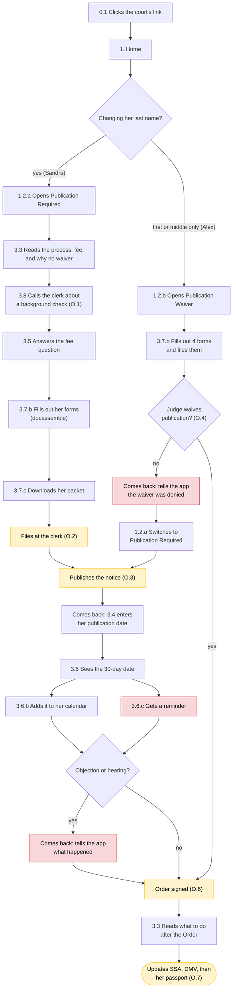

# Name change action inventory: adult, North Dakota

Every action an adult can take on the name change path at the North Dakota Court System's instance, with its route and whether it's built. Mapped from the code on `main` as of 2026-11-17 (b20fec4a), following Sandra's name change story ([#311](https://github.com/freelawproject/litigant-portal/issues/311)), with one branch from Alex's ([#312](https://github.com/freelawproject/litigant-portal/issues/312)). Tracked in [#1196](https://github.com/freelawproject/litigant-portal/issues/1196).

When the code and this doc disagree, trust the code and fix the doc. As MVP gaps get issues, link them from the action they cover.

The doc has three parts, each backing the next:

1. **Sandra's story:** why she needs the actions at all.
2. **User flow:** her path in order, with its decision points. Each step names the inventory action it uses.
3. **Action inventory:** every action, screen by screen, with its route.

A step in the flow with no inventory number is a gap that neither list caught on its own.

**Why name change.** It's the one flow that runs end to end today: guided page, interview, review, and a docassemble packet. It also has the longest stretch of work outside the app (clerk, newspaper, judge), where the user leaves and comes back with something new. That loop is what this map tests.

## Sandra's story

Sandra ([#311](https://github.com/freelawproject/litigant-portal/issues/311)) is 54, lives in Bismarck, and wants her birth name back seven months after her divorce. Her passport application needs a court order, and her divorce decree doesn't include one. She works on a laptop, in the evening, and wants a map, not a lawyer. What she needs, and what in the product answers it:

| Sandra's situation                                         | What she needs                                                | Actions                       |
| ---------------------------------------------------------- | ------------------------------------------------------------- | ----------------------------- |
| Thought her divorce decree changed her name                | To learn it's a separate petition, without feeling she failed | 1.1, 2.5, 3.3                 |
| Doesn't know about publication, the 30-day wait, or $160   | The whole process and its costs up front                      | 3.3                           |
| Restoring a last name, so no publication waiver            | To know why she doesn't qualify, plainly                      | 1.2, 3.3                      |
| Five forms, a blank case number, an Order she mustn't sign | The right forms, filled in correctly                          | 3.5, 3.7, 2.6                 |
| Judge may order a background check                         | To call the clerk before she starts                           | 3.3, 3.8, O.1                 |
| Publishes, then waits 30 days; someone could object        | Her date, and what to do if an objection comes                | O.3, 3.4, 3.6, 3.3            |
| Passport waiting; SSA, DMV, bank, employer, title          | The order to update her records in                            | 3.3, O.7                      |
| Comes back between steps over 6 to 8 weeks                 | Her work where she left it                                    | A.2, A.5, 1.4                 |

**Alex's branch** ([#312](https://github.com/freelawproject/litigant-portal/issues/312)): Alex changes only a first and middle name, so they ask the judge to waive publication. If the judge says no, Alex comes back, switches to the standard track, and publishes. That's the clearest case of the user returning with news the app has to act on, so the flow includes it.

## User flow

Sandra's path, from the court's link to her passport, with Alex's branch on the left. Red steps are MVP gaps. A yellow step has no inventory action yet.

Red = MVP gap in the inventory · yellow = no inventory action yet

**Steps with no inventory action**

- **Files at the clerk, publishes the notice, gets the Order, updates her records:** all done outside the app. The page explains each one; the app doesn't know when any of them happens. See O.
- **Tells the app what happened** (waiver denied, objection received, hearing set): there's nowhere to record it, so the page can't change what it shows next. Today the user scrolls to the static section that fits (`waiver_denied`, `objections`, `hearing`).

**Endpoint:** Sandra has a signed Order, certified copies with the Confidential Information Form attached, and her records updated in order, ending with her passport.

## Action inventory

**Markers**

- no marker = built, in production
- **[tester]** = only behind a `features.*` flag or the tester menu; not in production
- **[MVP, not built]** = needed for MVP, not built yet (assumes text and email sending exist)
- **[note]** = something the code shows that's worth checking

Every screen shares the frame: header on top, **Activity** region on the left, **Briefcase** region on the right. On phones the regions are drawers opened from header buttons.

---

### 0. Entry

- 0.1 Click the court's link → `/` (home)
- 0.2 Court deep link → enters the flow further down (e.g. straight to 3, `/t/north-dakota/adult-name-change/standard/`)

### H. Header (every page)

- H.1 Seal, court name, or logo → `/`
- H.2 Open Activity drawer (phones)
- H.3 Open Briefcase drawer (phones)
- H.4 Court switcher **[tester]**
- H.5 Signed out (desktop): Sign in → A.1 · Sign up → A.2
- H.6 Signed in (desktop): "You are logged in" menu
  - H.6.a Profile → `/profile/` (P)
  - H.6.b Admin → `/admin/` (staff only)
  - H.6.c Sign out → `/accounts/logout/` (A.4)
- H.7 Hamburger menu
  - H.7.a Phones only: the H.5 or H.6 account links, above the rest
  - H.7.b Get help → `/help/`
  - H.7.c About → `/about/`
  - H.7.d Privacy → `/privacy/`
  - H.7.e Accessibility → `/accessibility/`
  - H.7.f Free Law Project → free.law (new tab)
  - H.7.g Tester tools **[tester]**: Start over, tester flow links, Style Guide, Feedback, build stamp

### 1. Home `/`

- 1.1 Type a question in "What do you need help with?" and press Search → `/chat/?q=…`; the chat opens and sends it as the first message (2)
- 1.2 Open a topic card, one per enabled flow:
  - 1.2.a "Adult Name Change (Publication Required)" → `/t/north-dakota/adult-name-change/standard/` (3)
  - 1.2.b "Adult Name Change (Publication Waiver)" → `/t/north-dakota/adult-name-change/waiver/` (3)
  - [note] The user picks the track before the page explains the waiver. Sandra has to know she doesn't qualify before she's told why
- 1.3 Activity (left)
  - 1.3.a First visit: "Start a chat" → `/chat/`
  - 1.3.b Return visit: open a past chat → `/chat/?thread=<id>`
  - 1.3.c Return visit: "Start a chat" → `/chat/`
- 1.4 Briefcase (right)
  - 1.4.a First visit: empty state, no action
  - 1.4.b Return visit: read saved answers, grouped
  - 1.4.c Show or hide a private answer (eye toggle)
  - [note] The briefcase holds saved answers only. Uploaded files live in chat's Attach dialog (2.4), and filled forms stay in docassemble

### 2. Chat `/chat/`

- 2.1 Type a message and send (Enter sends, Shift+Enter adds a line)
- 2.2 New chat
- 2.3 Thread actions menu → Delete → confirm or cancel
- 2.4 Attach files (dialog)
  - 2.4.a Drag and drop, or browse (PDF, Word, Excel, images, text; up to 20 MB each)
  - 2.4.b Pick from "Your files" (earlier uploads)
  - 2.4.c Delete an earlier upload → confirm
  - 2.4.d Attach selected, or cancel
  - 2.4.e Remove an attachment before sending
  - 2.4.f Send files with no message
  - [note] Neither name change story uploads anything. Sandra could upload her divorce decree; Alex wouldn't
- 2.5 Read the reply
  - 2.5.a Copy a message
  - 2.5.b Open a citation chip → the guided page section it cites **[tester]** (`features.citation_chips`; check whether it's on in production)
  - 2.5.c Show details on a tool card ("Saving what you told me")
- 2.6 Review box (after the assistant gathers facts)
  - 2.6.a Read each answer and its evidence ("From your document" / "Because you said")
  - 2.6.b See what's still needed
  - 2.6.c Confirm my answers
  - 2.6.d Correct an answer by telling the assistant in chat
  - 2.6.e "Fill out your forms" (new tab, docassemble, prefilled from confirmed answers): same handoff as 3.7.b
  - 2.6.f "Open the guide" → the guided page (3)
- 2.7 Activity (left): switch to another chat
- 2.8 Briefcase (right): live saved answers (same actions as 1.4)

### 3. Guided page `/t/north-dakota/adult-name-change/<track>/`

`<track>` is `standard` (Publication Required) or `waiver` (Publication Waiver). The two tracks share their questions, so answers saved on one show up on the other.

- 3.1 Left region: jump to a section
  - Standard: Changing your legal name in North Dakota · Filing fee · Criminal history background check · Where to file · Asking the judge to skip the newspaper notice · Publishing your notice · The questions this page asks · Your answers · Your forms · Before you sign · Will there be a hearing? · If someone objects to your petition · Your deadlines · Who to contact · Resources · After the judge signs your Order
  - Waiver: Asking to change your name without publishing notice · Who can file · What it costs · Criminal history background check · Where to file · The question this page asks · Your answers · Your forms · About the publication waiver · If the judge does not waive publication · Before you sign · Will there be a hearing? · Who to contact · Resources · After the judge signs your Order
- 3.2 Left region: Exit this guide → `/`
- 3.3 Read info sections (the non-form sections listed in 3.1)
- 3.4 Your answers (form): the questions the page reacts to
  - 3.4.a Do you need the filing fee waived? (both tracks)
  - 3.4.b The date your notice was published (standard only)
  - 3.4.c Clear a saved private answer
  - 3.4.d Save answers → page reloads with the packet and deadline updated
- 3.5 Fee waiver: answering yes adds the fee waiver petition to the packet (3.7)
- 3.6 Deadlines (standard only; the waiver track has none)
  - 3.6.a Read "30-day publication waiting period ends"
  - 3.6.b Add to calendar (.ics download): shows once the publication date is entered
  - 3.6.c Get a reminder before the date by text or email **[MVP, not built]**
  - 3.6.d Send the date to me by text or email **[MVP, not built]**
- 3.7 Packet
  - 3.7.a Open each blank form (the North Dakota Court System's PDFs, new tab): 5 on standard (Petition, Declaration, Notice, Confidential Information, Order), 4 on waiver (no Notice), plus the fee waiver petition when 3.5 is yes
  - 3.7.b Fill out your forms → POST to `…/interview/`, opens docassemble in a new tab, prefilled with her name and county
  - 3.7.c Answer the rest of the interview and download the completed packet (in docassemble)
  - 3.7.d Send the packet to me by email **[MVP, not built]**
  - [note] The handoff shows only when this instance has docassemble configured. The `ndnamechange` package isn't installed on North Dakota's docassemble yet ([#556](https://github.com/freelawproject/litigant-portal/issues/556))
  - [note] The fee waiver petition is listed in the packet but isn't in the docassemble interview, so it's never filled in
  - [note] The prefill sends four answers (name and county). Everything else the user saved on the page or in chat gets asked again in docassemble
- 3.8 Contacts
  - 3.8.a Call, email, or open the website: Clerk of District Court (your county), North Dakota Legal Self Help Center, Legal Services of North Dakota, Dakota Plains Legal Services, State Bar Association of North Dakota (Lawyer Referral)
  - 3.8.b Add to contacts (.vcf download)
  - 3.8.c Send contacts to me by text or email **[MVP, not built]**
- 3.9 Resources: open each link (new tab)
- 3.10 Briefcase (right): same actions as 1.4
- [note] No link from the guided page into chat; the only way back to chat is H.1 → home, or the Activity region on other pages

### O. Outside the app, and coming back

The steps the user does somewhere else, and what the app does when they return. This is where name change is longest: 6 to 8 weeks between the first visit and the Order.

- O.1 Calls the clerk about a background check before filing: guided by 3.3 and 3.8; nothing to record
- O.2 Files the packet at the clerk: nothing to record **[MVP, not built]** (mark the packet filed)
- O.3 Publishes the notice in the county's official newspaper: records the date (3.4.b), which sets the deadline (3.6)
- O.4 The judge rules on the waiver (waiver track) **[MVP, not built]**: no way to record "granted" or "denied". On a denial the user reads "If the judge does not waive" and switches tracks themselves (H.1 → 1.2.a). The Notice they now need is in Resources, not the packet
- O.5 Receives an objection, or a hearing is set **[MVP, not built]**: no way to record it; the page shows the same static sections either way
- O.6 The judge signs the Order **[MVP, not built]**: no way to record it, so the page keeps showing pre-filing steps first
- O.7 Updates SSA, DMV, passport, and the rest: guided by "After the Order" (3.3); no checklist to tick off
- [note] Recording an update and changing what the page shows next is the same branching that [#930](https://github.com/freelawproject/litigant-portal/issues/930) and [#970](https://github.com/freelawproject/litigant-portal/issues/970) move into the engine

### A. Account `/accounts/`

- A.1 Sign in `/accounts/login/`
  - A.1.a Email, password, Remember me → Sign in → `/` signed in
  - A.1.b "Create one" → A.2
  - A.1.c Forgot password link **[MVP, not built]**: the reset page exists (A.3), but nothing links to it from sign in
- A.2 Sign up `/accounts/signup/`
  - A.2.a Email, password, confirm → Create account → `/` signed in
  - A.2.b Privacy Policy link
  - A.2.c "Sign in" → A.1
  - A.2.d Verify email **[MVP, not built]** (verification is off, `settings.py:293`)
- A.3 Reset password `/accounts/password/reset/`
  - A.3.a Enter email → Send reset link
  - A.3.b Open the link from the email → set a new password **[MVP, not built]**: needs real email (issue #1177)
- A.4 Sign out `/accounts/logout/` → confirm, or cancel back to `/`
- A.5 Anonymous work at sign-in: keep it or start fresh **[MVP, not built]** (issue #1179)
- [note] Alex's story says the flow must work without an account. It does today; accounts only matter for coming back on another device

### P. Profile `/profile/` (signed in)

- P.1 Read contact info and address
- P.2 Edit → `/profile/edit/`: name, phone, address, city, state, ZIP, county → Save Profile, or Cancel
- P.3 Change password **[MVP, not built]**: `/accounts/password/change/` exists, but only the admin users page links to it
- P.4 Change email **[MVP, not built]**
- P.5 Set how she wants messages: text, email, or both **[MVP, not built]**
- P.6 Delete my account and data **[MVP, not built]** (issue #986)

### S. Info pages

- S.1 Get help `/help/`: the court's website, the court's self-help resources, who to contact
- S.2 About `/about/`
- S.3 Privacy `/privacy/`
- S.4 Accessibility `/accessibility/`

### Post-MVP

- E-file the packet (issues #122, #1023)
