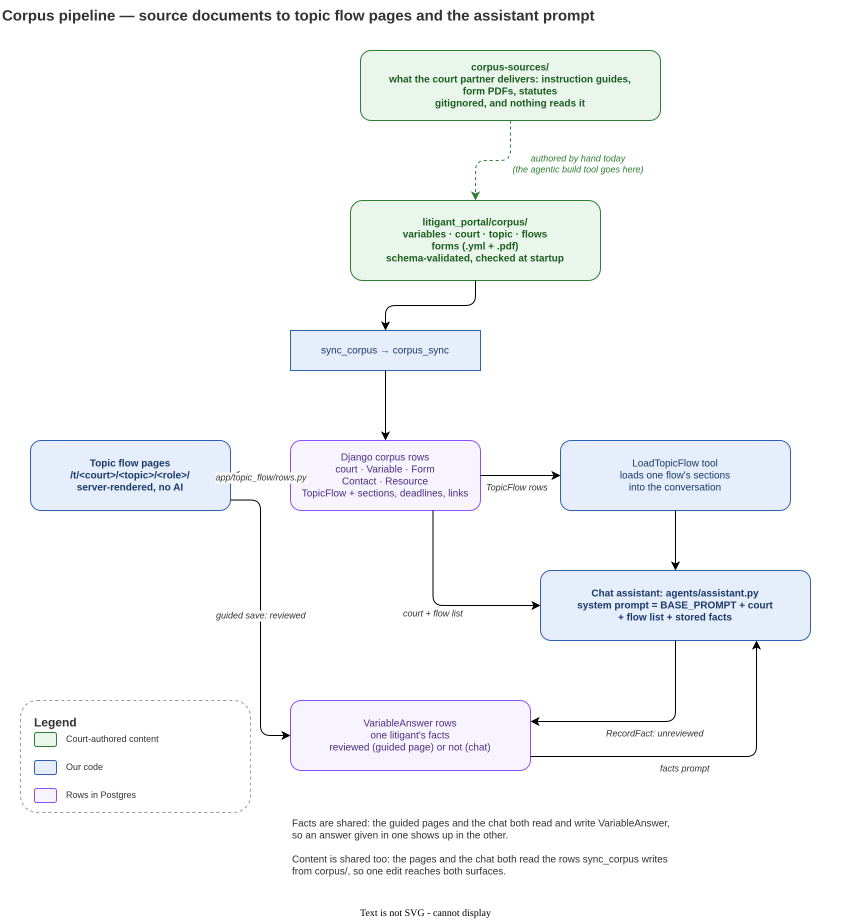

# Corpus pipeline

How source documents become the topic flow pages and the assistant's prompt, and how the
two surfaces share a litigant's facts.

Source: `corpus-pipeline.drawio`. Editing and SVG regeneration follow [README.md](README.md).

## The premise

The non-AI topic flow and the AI assistant should answer from one source of truth.
Improve a flow and both surfaces improve.

That holds today for **facts**: the guided pages and the chat both read and write
`VariableAnswer`, so an answer given in one shows up in the other. Since #1018 it holds
for **content** too: the pages and the chat both read the rows `sync_corpus` writes from `corpus/`.

## Layer 1: source documents

`corpus-sources/` holds what court partners deliver: instruction guides, form PDFs,
statutes. It is gitignored apart from its README (partner binaries, and the durable
home is the wiki).

Nothing reads it. Source documents become corpus YAML because a person reads them and
writes the YAML. That step is where the agentic build tool goes, and it currently has
no schema on the input side and no coverage check on the output side. An omission is
invisible: North Dakota's instructions give two statutory grounds for waiving
publication, our flow prose carried one, and no check noticed.

## Layer 2: repository trees

| Tree                      | Holds                                                   | Read by                                   |
| ------------------------- | ------------------------------------------------------- | ----------------------------------------- |
| `litigant_portal/corpus/` | variables, court, topic, flows, forms (`.yml` + `.pdf`) | `selectors/corpus.py`, then `sync_corpus` |
| `litigant_portal/agents/` | `BASE_PROMPT` and the court, flow and facts templates   | the chat assistant, assembled per turn    |

`corpus/` is the contract boundary. It is schema-validated and checked at startup, so
it is the right emit target for a build tool.

The public flow pages at `/t/<court>/<topic>/<role>/` render from the rows.

## Layer 3: build step

One publisher reads `corpus/`: `sync_corpus` → `services/corpus.py` writes the Django
rows. That is the site's court config, the `Variable` glossary, `Form` and its fields,
`Contact` and `Resource`, and each `TopicFlow` with its sections, interview pages, form
conditions, deadlines and links.

## Layer 4: run time

**Guided pages.** `app/selectors/state.py` adapts the `TopicFlow` graph and stored facts into the shared state projection. Every authored question group participates according to its conditions. The page renders the next unfinished component through `app/topic_flow/rows.py` and provides navigation to all applicable components. Saving writes reviewed facts through the reducer; Continue records the displayed content signature. Hidden answers stay stored and reappear when their conditions apply again.

**Chat.** The assistant (`agents/assistant.py`) separates shared instructions and court sources from the identity prompt. `LoadTopicFlow` selects the thread's active flow and refreshes the identity prompt with its projected guidance, applicable facts, and progress. `RecordFact` writes unreviewed facts through the same reducer and requests another refresh. `ReviewFacts` displays applicable answers for human confirmation.

**Docassemble prefill** sends only applicable, reviewed answers, so a fact the chat recorded reaches a court form only after a person confirms it.

## Known gaps

- No contract or tooling between source documents and `corpus/`, and no coverage check.
- No statute text in `corpus-sources/`, and no separate decision-tree document. Flow selection and authored conditions define the available paths.
- No fallback to the guided flow when the AI is unavailable (#950).
- `docs/wiki/ai-tone-guide.md` is the cross-court tone guide in prose. It is not wired
  into any prompt layer.
